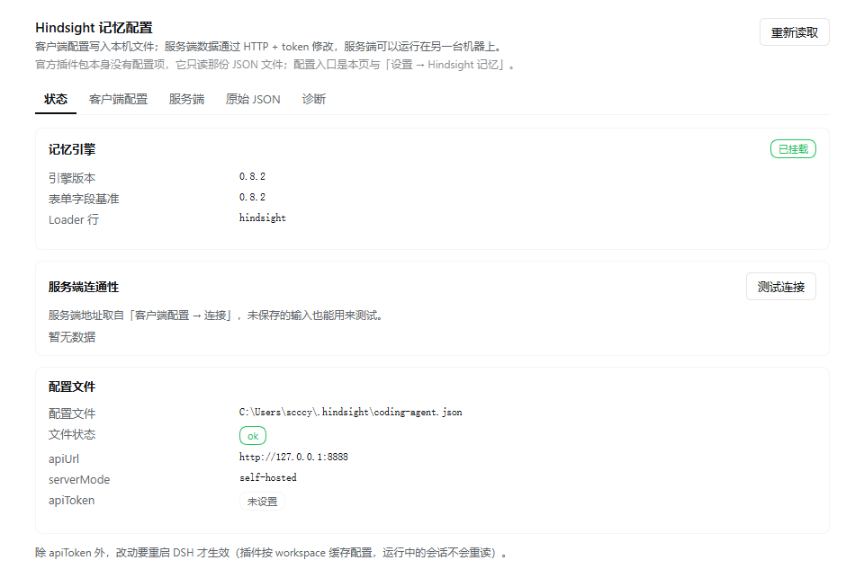
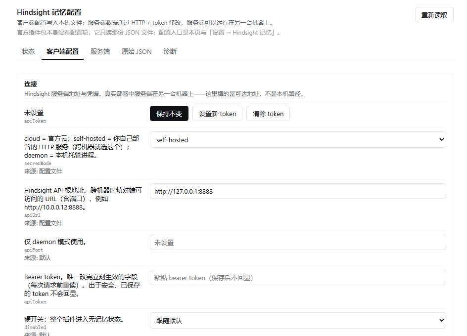

# dsh-hindsight-config

Hindsight 记忆（`@vectorize-io/hindsight-coding-agents`）的 **伞包 + 可视化配置面板**。

一个包做两件事：

1. **引擎**：patch 里插入 `id: hindsight` 行（`@vectorize-io/hindsight-coding-agents/dsh`）——记忆注入、`hindsight_*` 工具、git 摄取、代码库勘察都由它提供。
2. **面板**：本包的 Host 路由 + 客户端 UI ——改本地配置、看服务端/bank 状态、改 bank 配置。

安装本包 = 上面两半一起到位。卸载本包 = 两半一起消失。

## 截图

| 状态页 | 客户端配置 |
| --- | --- |
|  |  |

---

## 安装

```bash
# 1) 从 npm（推荐，市场也是走这条）
dsh plugin --profile <profile> add dsh-hindsight-config

# 2) 本地目录（开发时）
dsh plugin --profile <profile> add D:/github/suijiwenti/dsh-hindsight-config
```

也可以从 **Plugins → Discover** 安装（市场条目见下）。安装后本包的 patch 会同时插入引擎行与面板行 —— **一个包，两半都到位**。

`dependencies` 声明了 `"@vectorize-io/hindsight-coding-agents": "^0.8.2"`，所以引擎作为普通 npm 依赖被一起拉下来（版本由 profile 的 lockfile 锁定）。

**不要再单独选装官方 bundle。** 两个 bundle 都选时，各自的 patch 都会插入一行引擎；Loader 按 `id` 索引（`newMap = Object.fromEntries(config.map(o => [o.id, o]))`，同一个 `store[id]` 槽），所以**后插入的一行覆盖前一行，只会挂一个引擎** —— 设计的去重靠的就是「复用官方 bundle 的 row id `hindsight`」。但如果你把本包的行改成别的 id，就会变成两份引擎、八个 `hindsight_*` 工具各注册两次（`node test/engine-mount.mjs` 可复现）。

---

## 许可与上游

- 本仓库（本包）以 **MIT** 发布，见 `LICENSE`。
- 本包**不包含**引擎代码，也不 vendor、不 fork 它：`@vectorize-io/hindsight-coding-agents` 是普通 npm 依赖，安装时由包管理器拉取。它的版本、发布与支持属于上游项目（[vectorize-io/hindsight](https://github.com/vectorize-io/hindsight)）。
- 说明一句：上游那个包的 `package.json` **没有 `license` 字段**。作为依赖使用不涉及再分发，但如果你要把它打包进镜像或离线分发包，请先向上游确认许可。
- 本包只复用上游的**配置文件格式**（`~/.hindsight/coding-agent.json`）、**服务端 HTTP API** 和一个 **Loader row id**（`hindsight`，用于去重）。上游若改动其中任何一项，本包需要跟进；状态页「引擎版本 vs 表单字段基准」的黄条就是为这件事准备的。

---

## 发布（维护者）

```bash
# 1) 版本：npm 不接受重复版本号
npm version patch        # 或 minor / major

# 2) 检查将要发布的内容（test/ 不应出现在列表里）
npm pack --dry-run

# 3) 发布
npm publish

# 4) 市场条目：往 github.com/awesome-dsh-plugin/awesome-dsh-plugin 提一条 entry 的 PR
#    官方 Discover（读 npm 包 dsh-plugin-catalog 的 index.json）与 dshmarket（读
#    awesome-dsh-plugin.com/plugins.json）都从那一份目录生成，不用分别提交。
#    jsdelivr 有缓存（cacheTtlMs 默认 10 分钟），刚发布不一定立刻出现。
```

索引条目里每个版本可以声明 `source: { type: 'npm' }`（装 `name@version`）或 `source: { type: 'git', url, commit, path? }`（装 pin 到 commit 的 git+https）。

---

## 两个入口

| 入口 | 说明 |
| --- | --- |
| 设置 → **Hindsight 记忆** | 独立设置页，不依赖 Plugins 列表，最稳的入口 |
| Plugins → **`dsh-hindsight-config`** | 本包自己的插件页（`plugins.bundle.config`，key = 本包包名） |

两处渲染同一块面板。

**官方插件页（`@vectorize-io/hindsight-coding-agents`）刻意不放卡片。** `plugins.bundle.config` 按 bundle 包名分发，技术上完全可以在它的页面上渲一份，但那样看起来像"官方包长出了配置项"，容易误导；官方包本身确实没有配置（无 `Config` schema、patch 行无 `config`，只读那份 JSON）。

---

## 面板

| 页签 | 内容 |
| --- | --- |
| 状态 | **记忆引擎**是否挂载 + 引擎版本 + 表单字段基准；服务端连通性（`/health`、`/version`、特性位）；配置路径与生效值 |
| 客户端配置 | 48 个字段 / 8 组：连接、注入与召回、写入与成本、仓库摄取、知识页、作用范围、诊断、高级对象 |
| 服务端 | bank 列表 + 统计（文档/节点/观测/待处理/失败/上次整合）+ **心智模型**（列表/刷新/预览/编辑/删除）+ **bank 别名**（增删、设为显示名）+ 15 个 bank 配置项（`PATCH /v1/default/banks/{id}/config`） |
| 原始 JSON | 整份 `~/.hindsight/coding-agent.json`，带校验；未知字段原样保留 |
| 诊断 | 生效值与来源（默认/env/文件/harness 覆盖）、生效中的环境变量、`plugin.log` / `diag.jsonl` / `usage.jsonl` 尾部 |

### 引擎自检（防止"假健康"）

面板自己就能连服务端、读 bank 统计、改 bank 配置 —— **即使引擎没挂也一切看起来正常**，只有真发一句话才会发现没有记忆。所以状态页第一张卡会明确报告：

- `已挂载` / `未安装` / `已安装，但未激活`（附 fiber 状态与 Loader 行 id）
- 引擎版本与**表单字段基准**（`fields.js` 的 `ENGINE_BASELINE`，当前 `0.8.2`）不一致时给黄条 —— 新字段可能还没进表单，用「原始 JSON」改或更新面板。

---

## 心智模型（知识页）怎么配

心智模型是服务端的原语，**知识页就是心智模型**。同一个页有两个 id，指向同一份记录：`kp-…`（知识树里的节点）和 `mm-…`（`/mental-models` 里的模型）—— 从任一侧 PATCH，另一侧立刻能看到（`test/mental-model-probe.mjs` 实证）。面板用的是 `mm-…`。

写入方向是 **客户端配置 → 引擎 → 服务端**。引擎每次会话检查漂移，把服务端改回配置的样子，所以：

| 页 | 引擎会重推什么 | 面板编辑时怎么办 |
| --- | --- | --- |
| 5 张内置页（taxonomy） | `source_query` + `tags` + `trigger` | 改 `source_query` 时**同时写客户端配置**（`pages.<页名>.source_query`），否则下次会话被覆盖 |
| initiative 页 / 自建页 | 只重推 `trigger`；`name`/`source_query` 只写一次 | `source_query` 直接 PATCH 即可，引擎不碰 |

面板的行为：

- **编辑 source_query**：先 PATCH 服务端（立刻生效），若该页属于内置 taxonomy，再把同一句写入 `pages`，并在界面上回报"同时已写入客户端配置"。
- **编辑刷新 cron**：只 PATCH 服务端，并明确提示"内置页的刷新节奏由配置里的全局策略托管，下次会话会被重推"。服务端**不接受 Jenkins 的 `H`**（引擎在客户端侧解析它），面板直接拒绝并提示填具体 5 段 cron。
- **刷新 / 预览（dry-run）/ 清空**：纯服务端操作，与配置无关。
- **删除**：纯服务端；内置页删掉后下次会被重新播种（想永久去掉请在 `pages` 里设 `false`）。

### 每个心智模型自己的配置

一层是 **bank 默认**（`mental_model_min_refresh_interval_seconds`、`knowledge_page_default_trigger`，在「服务端 → bank 配置」），另一层是**每一页自己的**：5 个顶层字段 + 17 个 trigger 字段。

| 字段 | 面板 | 说明 |
| --- | --- | --- |
| `name` / `source_query` / `max_tokens` / `tags` | 表单 | 名称、提问、内容上限、标签 |
| `trigger.mode` | 表单 | `full` 每次整篇重写 / `delta` 只做增量编辑 |
| `trigger.budget` | 表单 | `low` / `mid` / `high`，按 `reflect_max_iterations` 的倍数 |
| `trigger.refresh_cron` | 表单 | UTC 5 段 cron，**不接受 `H`** |
| `trigger.refresh_after_consolidation` | 表单 | 每次观测整合后刷新；**与 `refresh_cron` 互斥**，开启会清掉 cron |
| `trigger.min_refresh_interval_seconds` | 表单 | 两次自动刷新的最小间隔 |
| `trigger.fact_types` | 表单 | 只检索哪些事实类型（`world` / `experience` / `observation`） |
| `trigger.tags_match` / `tag_groups` / `exclude_mental_models` / `exclude_mental_model_ids` / `include_chunks` / `recall_max_tokens` / `recall_chunks_max_tokens` / `reflect_search_observations_*` / `response_schema` / `keep_trace` | **高级 JSON** | 其余 10 个字段在「高级 JSON」里改 |

高级 JSON 编辑的是整份模型配置，Host 侧仍走白名单（未知的 `trigger` 键会被丢弃，不会透传到服务端）。

服务端对 `trigger` 是**按字段合并**的：只发你改的键，其余保持不变；唯一的例外是上面那条 cron / after-consolidation 互斥。

---

## 改目录名时怎么保住记忆（bank 别名）

bank id 由**目录名**推导（`coding-agent::{gitProject}`），工作区标题不参与。所以：

| 操作 | bank |
| --- | --- |
| 改 DSH 工作区标题 | 不变 |
| 改磁盘目录名 | 变成新名字 → **一个全新的空 bank**，旧记忆仍在旧 id 下 |

要改名又不丢记忆，用**别名**（服务端功能，面板「服务端 → Bank 别名」可直接操作）：

1. **先**给旧 bank 加别名 = 新目录名（例如 `coding-agent::dsh-插件开发`），可选「设为显示名」
2. **再**改文件夹名
3. 之后新会话按路径解析到新名字 → 命中别名 → 写进同一个 bank

顺序不能反：别名要求"不能已经是某个 bank 或另一个别名"，若先改目录并开过会话，会先建出一个空 bank，别名就加不上了。

备选（不动服务端，只改客户端）：`mapPathToBank` 或 `banks.<新id>.bank = 旧id`，两者都是"新名字 → 旧 bank"的重定向。

---

## 关键前提：服务端可能不在本机

真实部署中 Hindsight 服务端是**跨机器**的。本插件的约束：

- 服务端只走 HTTP（`fetch` 到 `apiUrl`），地址与 token 来自 `~/.hindsight/coding-agent.json`；**不读、不写、不假设**服务端上的任何文件或进程。
- 唯一强制 localhost 的分支是 `serverMode: "daemon"`（按定义就是本机进程）。
- **token 永不进浏览器**：`/state` 只回 `hasToken`，代理请求在 Host 侧带 token；连无法解析的配置文件也只回打过码的文本。
- 路由守门：同源 / loopback，并复用宿主的 `connection.requestRejection`（浏览器带 cookie 能过，裸请求 401）。

## 生效时机

- `apiToken`：**立即生效**（引擎每次请求前重读）。
- 其余字段：**需要重启宿主**。引擎按 workspace 首次解析配置并缓存在模块级 Map 里，运行中的会话不会重读。
- 写入是原子的（临时文件 + rename），写前把旧内容存为 `~/.hindsight/coding-agent.json.hindsight-ui-backup`。

已知风险：若配置文件不是合法 JSON，引擎会打一行 `console.error` 然后**当作 `{}`**（全部配置静默失效）。面板会把这个状态显式报出来，并要求显式确认才允许覆盖。

---

## 测试

```bash
node test/smoke.mjs              # Host 路由 / 真实端点 / 不可达错误 / 引擎自检 / patch 形状
node test/save-roundtrip.mjs     # 写入回环（临时文件，不动真实配置）
node test/client-contract.mjs    # 客户端契约：两处注册、字典键一致、summary/page 渲染
node test/fiber-harness.mjs      # 真实 cordis：apply 是否落定（抓过 "did not activate"）
node test/engine-mount.mjs       # 引擎能否被外部挂载 / 挂两次会不会重复注册工具
node test/alias-roundtrip.mjs    # bank 别名：增删/primary/中文名/重复拒绝（临时 bank，跑完即删）
node test/mental-model-routes.mjs # 心智模型：列表/编辑/配置同步/cron 校验/删除（临时 bank）
node test/mental-model-probe.mjs # 探查：kp- 与 mm- 两个 id 是否同一份记录
```

两个测试需要本机有一份 Harness 安装或引擎副本，找不到会打印 `SKIP` 并以 0 退出：

- `fiber-harness.mjs`：用 `DSH_PACKAGES_DIR=<dsh>/node_modules/@deepseek-ai` 指定 cordis 所在目录
- `engine-mount.mjs`：自动扫描 `~/.dsh/profiles/*/node_modules/`，或用 `DSH_ENGINE_PATH` 指定 `dist/dsh.js`

## 已知约束

- **卸载互锁**：本包的 patch 与官方 bundle 共用 row id `hindsight`（去重的代价）。当官方 bundle 也在同一 profile 里启用时，`remove_bundle` 会被 `bundle-in-use` 拒绝 —— 因为那个 entry 仍被另一个已启用的 bundle 使用。两个办法：先禁用官方 bundle 再移除，或者直接**停用**本包（`set_bundle enabled:false`，此时 patch 不应用、路由不注册、客户端不加载，效果等同于卸载）。
- `fields.js` 的默认值与枚举抄自引擎 **0.8.2**（README 的 Reference 表 + `dist/dsh.js` 的 `resolveConfig`）。引擎升级后新增字段不会自动出现在表单里，但「原始 JSON」页签始终可用，状态页也会提示版本漂移。
- 上游 bundle 的 patch 行目前没有 `config`；若将来加了，本包的引擎行需要同步，否则会用自己的空配置覆盖它。
- 深层映射（`banks` / `paths` / `pages` / `customPages` / `recallOptions` …）在「高级对象」里按原始 JSON 编辑，不做结构化编辑器。
